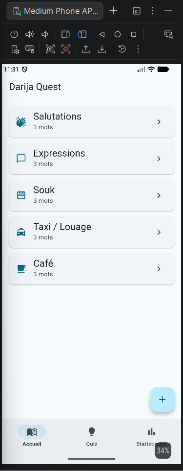
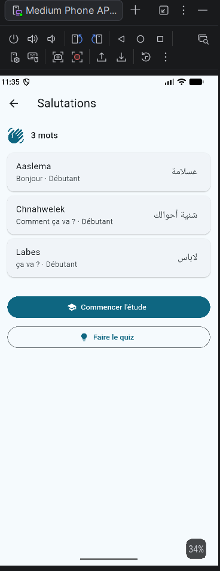
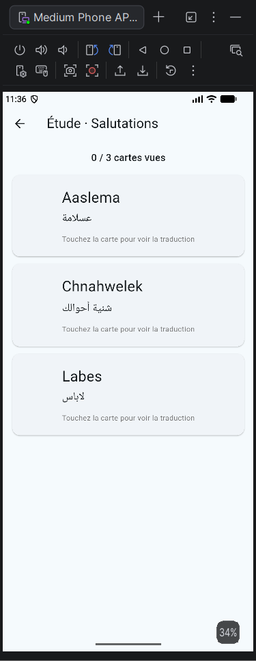
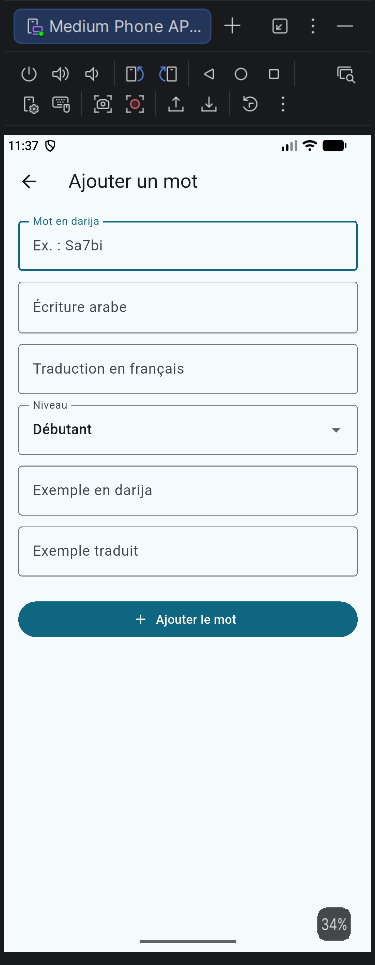
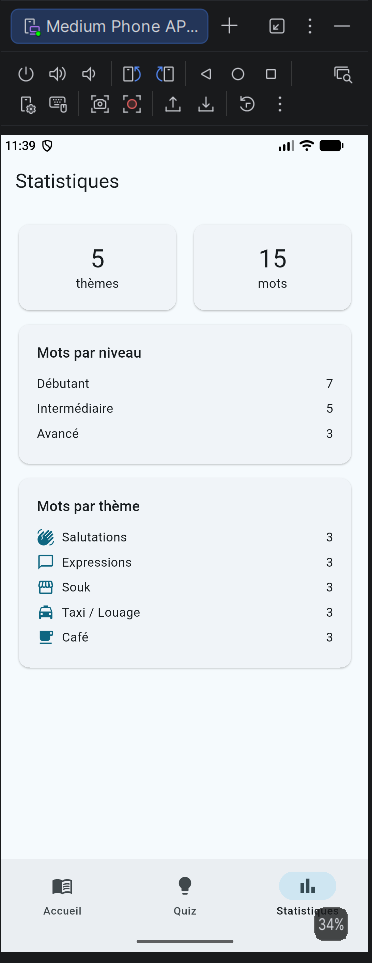

# Darija Quest 

Une application pour apprendre le dialecte tunisien (darija) : cartes à
retourner, quiz et statistiques, pour les étudiants étrangers et toute
personne qui veut parler tunisien.

Vous trouvez notre Journal AI attaché ci-joint.

## Jalon J1 — squelette de l'application

Application Flutter à 6 écrans. Données fictives codées en dur :
pas d'API, pas de Provider, pas de validation, pas de persistance à
ce stade (exigences du jalon J1).

### Captures d'écran (une par écran)

| Écran | Capture |
|---|---|
| Accueil — liste des thèmes |  |
| Détail d'un thème — passage d'objet |  |
| Étude — cartes recto/verso |  |
| Quiz — question à 4 choix |  |
| Ajouter un mot — formulaire |  |
| Statistiques |  |

### Schéma de navigation (une ligne par trajet)

- Accueil → Détail du thème
- Détail du thème → Étude du même thème
- Détail du thème → Quiz du même thème
- Accueil (bouton « + ») → Formulaire « Ajouter un mot »
- Barre inférieure : Accueil ⇄ Quiz ⇄ Statistiques

### Répartition du travail (J1)

| Membre | Travail |
|---|---|
| **Oussama** | squelette Flutter et `main.dart`, modèles `Mot` (7 attributs) et `ThemeDarija`, données fictives (5 thèmes, 15 mots), écran Accueil, écran Détail |
| **Rayen** | coquille de navigation `AppShell` (barre inférieure), écran Étude, écran Quiz, écran Formulaire « Ajouter un mot », écran Statistiques |

### Journals IA

**Oussama**  :  https://chatgpt.com/share/6af83adb-d09c-83e9-8777-4cad6bd96023

**Rayen**    : https://chatgpt.com/share/6af86b6d-e968-83ea-91a8-91be13d1b61e

## Jalon J2 — données 

L'application utilise maintenant une vraie API au lieu des données fictives.

### API utilisée

- URL : https://darija-quest-api.onrender.com
- Express + MongoDB Atlas (base `darija-quest`, collection `mots`)
- Routes : GET /, GET /api/mots, GET /api/mots/:id, GET /api/themes, POST /api/mots, PUT /api/mots/:id, DELETE /api/mots/:id

### Fonctionnalités

- Accueil, quiz et statistiques lus depuis l'API, avec chargement et gestion d'erreurs
- Formulaire « Ajouter un mot » validé (EF3) avec retour vers l'accueil (EF4)
- Favoris partagés entre l'accueil et le détail avec Provider (EF5)

### Répartition du travail (J2)

| Membre | Travail |
|---|---|
| Oussama | API Express, MongoDB, déploiement Render, package http, service API, modèle JSON |
| Rayen | écrans API, validation, formulaire, tests, Provider des favoris |

### Journals IA(J2)

**Oussama**  : https://chatgpt.com/share/6b057418-5c34-83e8-910f-d9b52379d8ed

**Rayen**    : https://chatgpt.com/share/6b06e32a-cfcc-83e9-a902-11f266c47ed0

## Jalon J3 — finitions (terminé)

Ce jalon ajoute la persistance, la recherche et les derniers points de qualité.

### Nouveautés

- **EF7** : les favoris sont sauvegardés avec `shared_preferences` et retrouvés au redémarrage.
- **EF8** : recherche par mot (`?recherche=`) et filtre par niveau (`?niveau=`) côté API et côté accueil.
- **ENF2 / ENF4** : couleurs remplacées par le thème et bouton cœur factorisé dans `lib/widgets/`.
- **Bonus J0** : mode sombre persisté, animation Hero de la carte vers le détail, 3 tests de widgets.
- **ENF7** : APK release publié sur GitHub.

### Répartition du travail (J3)

| Membre | Travail |
|---|---|
| **Oussama** | recherche et filtres dans `GET /api/mots`, déploiement Render, APK, Hero, widget cœur, README et journals IA |
| **Rayen** | `shared_preferences`, écran de recherche, mode sombre, 3 tests de widgets, correctifs de thème |

### Téléchargement

APK : http://github.com/oussama-hlali/Darija-Quest/releases/tag/v1.0.0

### Journals IA (J3)

**Oussama** : https://chatgpt.com/share/6b099a5a-1784-83e9-93a9-be27fbe16e83

**Rayen** : https://chatgpt.com/share/6b06e32a-cfcc-83e9-a902-11f266c47ed0
