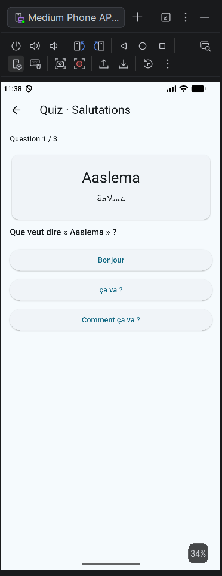

# Darija Quest 

Une application pour apprendre le dialecte tunisien (darija) : cartes à
retourner, quiz et statistiques, pour les étudiants étrangers et toute
personne qui veut parler tunisien.

Vous trouvez notre Journal AI attaché ci-joint.

## Jalon J1 — squelette de l'application

Application Flutter à 6 écrans. Données fictives codées en dur :
pas d'API, pas de Provider, pas de validation, pas de persistance à
ce stade (exigences du jalon J1).

### Captures d'écran (une par écran)

| Écran | Capture |
|---|---|
| Accueil — liste des thèmes |  |
| Détail d'un thème — passage d'objet |  |
| Étude — cartes recto/verso |  |
| Quiz — question à 4 choix |  |
| Ajouter un mot — formulaire |  |
| Statistiques |  |

### Schéma de navigation (une ligne par trajet)

- Accueil → Détail du thème
- Détail du thème → Étude du même thème
- Détail du thème → Quiz du même thème
- Accueil (bouton « + ») → Formulaire « Ajouter un mot »
- Barre inférieure : Accueil ⇄ Quiz ⇄ Statistiques

### Répartition du travail (J1)

| Membre | Travail |
|---|---|
| **Oussama** | squelette Flutter et `main.dart`, modèles `Mot` (7 attributs) et `ThemeDarija`, données fictives (5 thèmes, 15 mots), écran Accueil, écran Détail |
| **Rayen** | coquille de navigation `AppShell` (barre inférieure), écran Étude, écran Quiz, écran Formulaire « Ajouter un mot », écran Statistiques |

### Journals IA

**Oussama**  :  https://chatgpt.com/share/6af83adb-d09c-83e9-8777-4cad6bd96023

**Rayen**    : https://chatgpt.com/share/6af86b6d-e968-83ea-91a8-91be13d1b61e